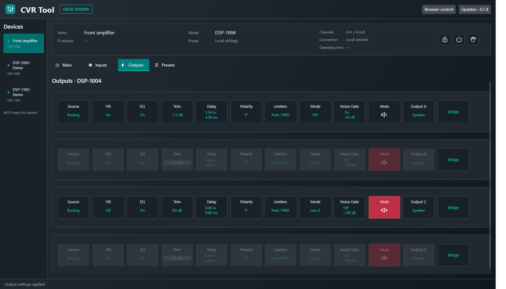

# CVR Tool

A cross-platform desktop app with integrated MCP for CVR DSP amplifiers.
The interface and functions follow the CVR application, with the same controls
for two- and four-channel models.

## Download

| Platform | Direct download | Start after extracting |
| --- | --- | --- |
| Windows x64 · Intel / AMD | [Download ZIP](https://github.com/Woodwarth/CVR-Tool/releases/download/v0.7.4/CVR-Tool-0.7.4-win-x64.zip) | `START-CVR-TOOL.cmd` |
| Windows ARM64 · Snapdragon | [Download ZIP](https://github.com/Woodwarth/CVR-Tool/releases/download/v0.7.4/CVR-Tool-0.7.4-win-arm64.zip) | `START-CVR-TOOL.cmd` |
| Mac · Apple Silicon | [Download archive](https://github.com/Woodwarth/CVR-Tool/releases/download/v0.7.4/CVR-Tool-0.7.4-osx-arm64.tar.gz) | `CVR Tool.app` |

[Latest release and checksums](https://github.com/Woodwarth/CVR-Tool/releases/latest).
Extract the entire package. The runtime is included; no SDK or additional
software is required. Desktop and integrated MCP share one bundled runtime.
Windows packages are unsigned; Mac is ad-hoc signed,
not notarized. No Intel Mac build.

From v0.4.0, choose **Updates → Check for updates → Download and restart**
inside the app. Updates are verified and installed in your user profile;
existing versions are retained. Export session settings before restarting.

Choose **Browser control → Start** to control the same session from an iPad
browser on your local network. Open the private connection link shown in the
desktop app; no iPad app or internet is required.

Desktop, browser and MCP share one local session. CVR devices are found automatically
on the wired amplifier LAN and listed beside the demos. Live settings and status
are displayed. Selected controls support independently verified writes; see
[network capabilities](docs/network.md) and [hardware validation](docs/validation.md).

[Development guide](docs/code-guide.md) · [MCP setup](docs/mcp.md) ·
[Network details](docs/network.md) · [Validation](docs/validation.md)

MIT license. Independent project; no manufacturer affiliation.
